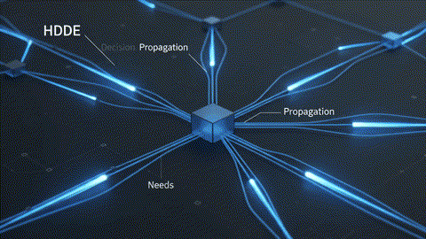

  <h1>AMLAACH</h1>
  <h3><code>Less hype. More code.</code></h3>

  

    <em>&ldquo;Bringing code that works to a world full of broken ideas&rdquo;</em>
  

  

    
    
    
  

---

### 💻 Core Specialization

<table>
  <tr>
    <td width="33%" align="center">
       
      <strong>Primary Domain</strong> 
      High performance, memory safety, zero-cost abstractions & systems programming
    </td>
    <td width="33%" align="center">
       
      <strong>Secondary Domain</strong> 
      AI orchestration, automation scripts, agents, rapid prototyping & tooling
    </td>
    <td width="33%" align="center">
       
      <strong>Third Domain</strong> 
      Modern UI, TypeScript, Electron, interactive frontends & web systems
    </td>
  </tr>
</table>

  
  
  
  
  
  
  
  
  

---

> *"Humans were creating unmaintainable spaghetti code long before AI existed; blaming AI is just unfair."*

---

### 🚀 Featured Projects

<table>
  <tr>
    <td width="100%" valign="top">
      <h3>📖 <a href="https://github.com/Amlaach/typesetok">TypesetOK</a></h3>
      
<em>Professional Desktop Publishing & Typesetting Software</em>

      
A true desktop publishing (DTP) software built from the ground up for precise document layout, complex multi-stream flows, typography shaping (including full RTL & Hebrew vocalization/nikkud support), and reproducible PDF generation.

      
      
      
      
    </td>
  </tr>
  <tr>
    <td width="100%" valign="top">
      <h3>🕹️ <a href="https://github.com/Amlaach/HDDE-A-Zero-Allocation-Hierarchical-Utility-Architecture">HDDE Architecture</a> <small><code>[Spare-Time / Research]</code></small></h3>
      
<em>Zero-Allocation Hierarchical Decision Engine</em>

      
Developed as a passion project exploring low-latency artificial life and simulation intelligence. Fuses Utility AI, hierarchical command propagation, and cache-coherent data-oriented ECS into a zero-allocation architecture running thousands of autonomous agents with deterministic predictability.

      
      
      
      
      
    </td>
  </tr>
  <tr>
    <td width="100%" valign="top">
      <h3>🔍 <a href="https://github.com/Amlaach/otzaria-semantic-search">Otzaria Semantic Search</a></h3>
      
<em>Vector & Semantic Retrieval Engine</em>

      
Advanced vector search backend and retrieval pipeline delivering instant semantic lookup over extensive textual corpora. Combines high-density vector embeddings with fast nearest-neighbor indexing for deep information discovery.

      
      
      
      
    </td>
  </tr>
</table>

---

  

    

  
  &nbsp;
  

    
  Less hype. More code. &bull; <b>Bringing code that works to a world full of broken ideas.</b>

